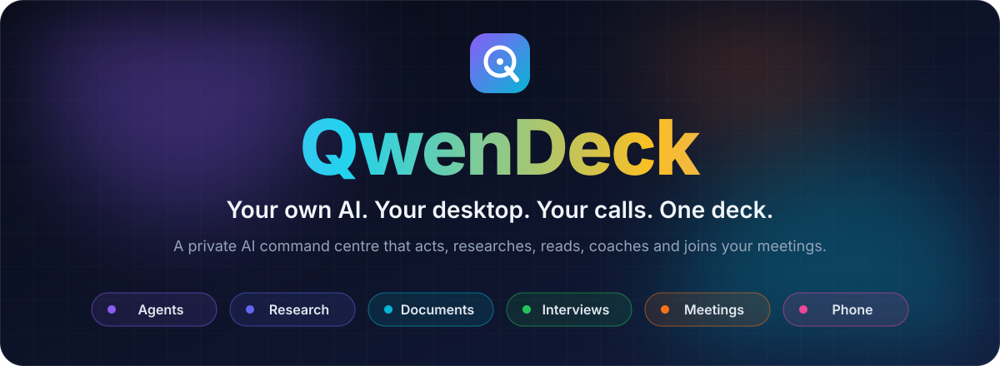
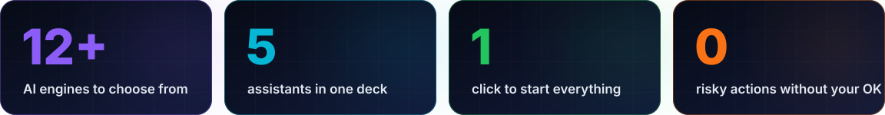
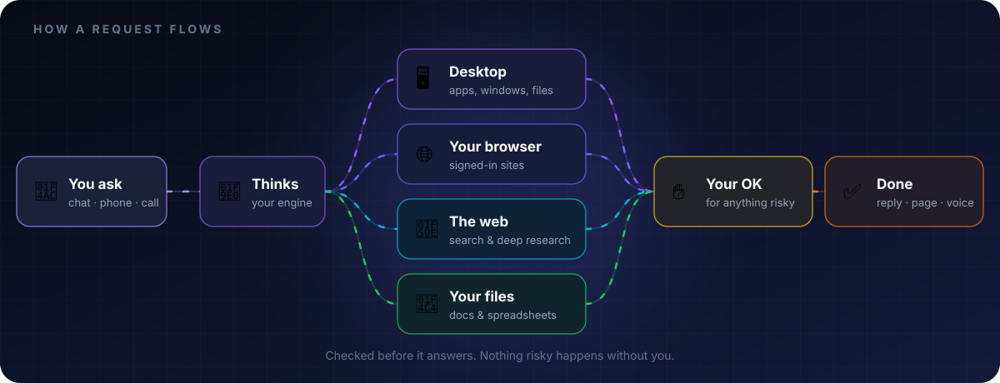

  

  
  
  
  
  
  

**[💬 Chat & Agents](#chat)** &nbsp;·&nbsp; **[📄 Documents](#docs)** &nbsp;·&nbsp; **[🎤 Interviews](#interview)** &nbsp;·&nbsp; **[🎧 Meetings](#meetings)** &nbsp;·&nbsp; **[📱 Everywhere](#everywhere)** &nbsp;·&nbsp; **[🌅 A day with it](#day)**

 

<em>Most assistants live in a tab. This one lives on your machine.</em>

 

> [!NOTE]
> **About this repo.** A **public overview** of a private project — what it does, not how it's built. The source is kept private.

 

 

## 🎯 What it is

**QwenDeck is a personal AI deck you run yourself** — your own model plus a team of assistants that don't just answer, they *do*. They open apps, work in your real browser, research the web, read your spreadsheets, prepare you for an interview, and join a call to listen, speak and write the notes.

Everything stays yours: the chats, the chatbots, the documents, the keys. You decide what the AI may touch, and anything risky waits for your approval.

 

## ⚡ Why it's different

| | A typical AI chat | **QwenDeck** |
| :-- | :--: | :--: |
| Whose model is it? | Someone else's | **Yours — pick any engine, per message** |
| Can it act on your computer? | ✗ | **✓ desktop + your real browser** |
| Reads your own files? | One upload at a time | **✓ a living library per chatbot** |
| Spreadsheet maths | Guessed | **✓ computed exactly** |
| Helps you get the job? | Generic tips | **✓ prep, mock interviews, scoring, coaching** |
| Shows up to your meetings? | ✗ | **✓ joins, speaks, takes notes, follows up** |
| Lives on your phone too? | Separate app | **✓ paired in seconds over your own Wi-Fi** |
| Does risky things on its own? | — | **✗ never without your OK** |

 

<table>
<tr>
<td width="50%" valign="top">

### 🧠 Your own model
Chat with a private model you control, with a **thinking** toggle for harder questions. Long conversations are summarised as they grow, so they never run out of room.

</td>
<td width="50%" valign="top">

### 🔀 Any engine, per message
Switch engine and model from a dropdown on any single message. If your main engine is asleep, a fallback steps in — or turn fallback off and get an honest "not available" instead.

</td>
</tr>
<tr>
<td width="50%" valign="top">

### 🤖 Agent mode
One toggle turns a chat into an agent that **plans → acts → checks → recovers**, then reports exactly what it did. Multi-step tasks, not one-shot answers.

</td>
<td width="50%" valign="top">

### 🖥️ Drives your desktop
Opens apps, clicks, types, reads windows and manages files — step by step, with anything destructive gated behind your approval.

</td>
</tr>
<tr>
<td width="50%" valign="top">

### 🌐 Works in your real browser
A companion extension lets the agent use **the browser you already use**, signed-in sites and all. Off by default, allowed site by site, a block list that always wins, and a log of every action.

</td>
<td width="50%" valign="top">

### 🔎 Web search & deep research
Searches and reads the web on its own. Research mode digs deeper and turns the findings into a **saved, shareable page** — ask for a report, get a link.

</td>
</tr>
<tr>
<td width="50%" valign="top">

### 🏗️ Builds whole projects
Ask for a site or a tool and it writes every file in one go, then shows you the real folder it created — no claiming files it never made.

</td>
<td width="50%" valign="top">

### 🧩 Many chatbots, one deck
As many chatbots as you like, each with its own persona, engine, documents, keys and training — one click apart on a side rail.

</td>
</tr>
</table>

 

<table>
<tr>
<td width="50%" valign="top">

### 📚 Talk to your files
PDFs, Word, slides and spreadsheets are read **while it answers**. Search works by meaning, not just keywords — and across languages.

</td>
<td width="50%" valign="top">

### 📊 Spreadsheets with real numbers
Totals, groupings, monthly breakdowns, highest and lowest rows — computed exactly, so the AI explains the figures instead of guessing them.

</td>
</tr>
<tr>
<td width="50%" valign="top">

### 🖼️ Reads scans and photos
Scanned pages and pictures of documents are read too, so nothing you upload is invisible.

</td>
<td width="50%" valign="top">

### 🎓 Train each chatbot
Teach a chatbot your style or your knowledge with one-click training. One base model, many personalities.

</td>
</tr>
</table>

 

<table>
<tr>
<td width="33%" valign="top">

### 📝 Prep
A question bank built for the exact role, **STAR stories** from your own background, a CV tailored to the job, company research and salary guidance.

</td>
<td width="33%" valign="top">

### 🎯 Mock
An AI interviewer asks one question at a time, **scores every answer out of 10**, says what worked and what to fix, and writes a stronger version.

</td>
<td width="33%" valign="top">

### 📈 Coach
Tracks pace, filler words and answer length across sessions, so you can watch yourself improve. Import your CV, GitHub and the job description in one click.

</td>
</tr>
</table>

 

**Before** &nbsp;🗓️&nbsp; → &nbsp;**During** &nbsp;🗣️&nbsp; → &nbsp;**After** &nbsp;🧾

<table>
<tr>
<td width="50%" valign="top">

### 🗓️ Knows your schedule
Reads your calendar and inbox. **CC Vyom on an invite** and it schedules the meeting, reads the thread for context and is ready at the start time. Only trusted senders can schedule it.

</td>
<td width="50%" valign="top">

### 📋 A brief before you walk in
Who's attending, what was decided last time, what's still open — with a heads-up on your phone and a one-tap Skip.

</td>
</tr>
<tr>
<td width="50%" valign="top">

### 🗣️ Listens, speaks, keeps up
Announces itself, knows who said what, reads the chat and shared slides, answers when addressed in a natural voice — and goes quiet the moment someone talks over it.

</td>
<td width="50%" valign="top">

### 🙋 Asks before it decides
When something needs you, Vyom pings your phone and waits. It never commits you to anything on its own.

</td>
</tr>
<tr>
<td width="50%" valign="top">

### 🧾 Notes worth reading
A designed notes page with **decisions, action items, key numbers and who spoke** — not a transcript dump. Export to PDF, Word or Markdown, or email attendees with one click — only when you press Send.

</td>
<td width="50%" valign="top">

### ✅ Follow-through
Action items become a task board with due dates and reminders. "**Catch me up**" summarises anything you missed, and Vyom remembers across meetings.

</td>
</tr>
<tr>
<td width="50%" valign="top">

### 👔 Hiring mode
Load the job description and get a scorecard, a fit-for-the-role analysis and side-by-side candidate comparisons — plus a private alert if answers sound AI-written.

</td>
<td width="50%" valign="top">

### 🎭 Your choice of role
**Private mode** listens on your laptop and whispers suggestions to your phone. **Participant mode** joins the call and takes part. Switchable personas and languages.

</td>
</tr>
</table>

 

<table>
<tr>
<td width="50%" valign="top">

### 📲 Phone companion
Pair your phone with a **6-digit code or a QR scan** on your own Wi-Fi. Live transcripts, suggestions, meeting alerts and Skip / Ask buttons, right in your hand.

</td>
<td width="50%" valign="top">

### 💬 Chat widget for your website
Put any of your chatbots on your own site with an embeddable chat bubble and a public API.

</td>
</tr>
<tr>
<td width="50%" valign="top">

### 🛡️ Private by default
Keys are stored encrypted, other devices need an access key, phones only see what they were paired for, and nothing is sent without your click.

</td>
<td width="50%" valign="top">

### 🚀 One click to start
A single launcher wakes your model, starts the deck and opens it. A usage counter shows what your AI did today.

</td>
</tr>
</table>

 

## 🌅 A day with QwenDeck

| | |
| :--: | :-- |
| ☀️ **8:00** | A morning digest lands: today's meetings, open action items, what's due. |
| 🔎 **9:30** | *"Research these three competitors and give me a page."* — a shareable report, sources and all. |
| 📊 **11:00** | Drop in the quarterly spreadsheet; ask what changed. The numbers are exact. |
| 🎯 **13:00** | Twenty minutes of mock interview for Friday's role. Scored, coached, rewritten. |
| 🎧 **15:00** | Vyom joins the team call, answers when asked, pings your phone once for a decision. |
| 🧾 **15:45** | Notes, decisions and a task board are ready. One click emails the summary. |
| 🤖 **17:30** | *"Sort today's downloads into folders."* — agent mode does it; you approve before anything moves. |

 

 

## 📌 Status

In active use and still growing. Chat, agent mode, research, documents, the interview studio, phone pairing and meeting notes work end to end; live joining across every video-call platform is being rolled out.

 

## ⭐ Like what you see?

**Star the repo** — that's how the next person finds it.

 

## 📬 Contact the developer

Interested in this or **any of Bhardwaj's projects** — a demo, a walkthrough, collaboration, or licensing?

### 📧 **[ys9410017064@gmail.com](mailto:ys9410017064@gmail.com)**

 

---

**Made with love by Yati Bhardwaj**

<a href="https://github.com/ys941">github.com/ys941</a> · <a href="mailto:ys9410017064@gmail.com">ys9410017064@gmail.com</a>

